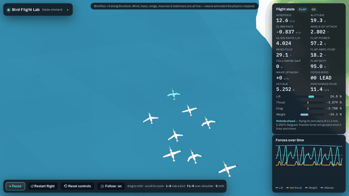

# Bird Flocking Lab


A browser-based physics lab for studying how **pelican flocks** fly: how individual birds generate thrust from flapping, how they save energy by drafting off one another, and how formations like the V form, hold together, and reorganize.

The whole lab is a single self-contained HTML file built on [three.js](https://threejs.org/). Open `index.html` in a browser; nothing needs installing.

## Why this exists

This is the latest of several attempts I've made over the years to simulate bird flight. Earlier pieces: [pelicans](https://github.com/willkessler/pelicans), a Processing flocking sim, and [springs_and_arms](https://github.com/willkessler/springs_and_arms), a workbench for articulated wing joints.

Classic [Boids](https://en.wikipedia.org/wiki/Boids) gets you convincing flocks from three local rules, but it cheats on the thing that matters most for formation flight: **propulsion**. A boid can step on the gas whenever it likes. A real bird has to pay for every bit of speed and every turn with muscle work, and that cost is the whole reason pelicans and geese fly in Vs: a bird sitting in the wingtip upwash of the bird ahead flies more cheaply.

So the goal here is to build the flock up from honest single-bird physics:

1. **Thrust has to come from the wing motion.** It isn't added as a force.
2. **Drafting has to come from a wake model.** The benefit of flying behind another bird should follow from the physics.
3. **Formation behavior should emerge from individual birds** responding to their own state (fatigue, airflow, neighbors) rather than from a choreographer placing birds in slots.

## What's simulated

**Single-bird aerodynamics (blade-element / strip theory)**
- Each wing is an **articulated two-segment** limb (inner arm plus outer hand) split into spanwise strips. Each strip computes its own local airflow (body motion, rotation, flapping velocity, wind, and wake) and its own lift and drag.
- Forward thrust **emerges** from the plunging downstroke (the Knoller–Betz effect). The wing **folds** at the elbow and wrist on the upstroke, which cuts upstroke drag and inertia.
- Per-segment angle of attack, feathering, wingtip-feather splay, and ground effect.
- **Muscle-driven mode:** the pectoralis and supracoracoideus are torque-limited by strength, length–tension, and Hill force–velocity curves. A bird that is too weak, or one with a rigid wing, can't sustain its wingbeat.
- Mass and bone thickness, head/tail mass distribution, a tail stabilizer, and active pitch/roll stabilization reflexes. Set the reflex gain to 0 to see the raw phugoid.

**Flock**
- **Self-organizing formation:** no slots, arms, or assigned leader. Each bird follows a handful of local rules (see [How the formation emerges](#how-the-formation-emerges-v13)).
- **Wingtip-vortex wake model:** a bird outboard of the tip of the bird ahead gets upwash (a lift bonus), and a bird inboard of it gets downwash. Near the water, mirror-image vortices partly cancel it.
- **Momentum slipstream:** directly behind another bird is a low-drag channel of co-moving air.
- **Intermittent flap-and-glide flight:** each bird decides beat by beat whether to flap or coast.
- **Surface skimming:** the flock periodically drops to ride ground effect just above the water, as pelicans do working a surf line.
- **Fatigue:** flapping harder than a bird's sustainable power builds fatigue, which weakens its flight muscles and lowers the pace it wants to fly. Birds differ in fitness and preferred pace.
- Coastline following, gusty turbulent wind, and headwind and crosswind.

**Viewing:** orbit camera, `1`–`9` to ride a bird's-eye view, `Shift`+`1`–`9` for an over-the-shoulder chase cam (drag to look around), and live telemetry and force charts for the focused bird.

## Repository layout

| Path | What |
|---|---|
| `index.html` | The current version of the lab (v13), which is where iteration happens |
| `versions/` | Every earlier build, kept for reference (see below) |
| `docs/conversation-notes.md` | Notes from the design conversation that produced v1 through v12 |
| `tools/flock-metrics/` | Headless harness that runs the flock physics and measures emergent structure |
| `media/` | README assets |

### Version history (`versions/`)

There are two naming series, in chronological order:

- `bird-sim.html`, `bird-sim_1` … `bird-sim_10` (Aug–Sep 2026): the single-bird lab. These cover the blade-element aero, the feathering fix, active stabilization, the articulated folding wing, and the torque-limited muscle model. `_4`, `_5`, and `_6` are identical snapshots.
- `bird-sim-v2` … `bird-sim-v12` (Sep 2026): the multi-bird flock. These add the wake and drafting model, V formation, lead rotation, flap-and-glide station keeping, coastline following, surface skims, turbulence, and camera modes. In these versions the V is choreographed: fixed slots, fixed arms, and a timed round-robin lead swap.
- `bird-sim-v13` (Nov 2026): the choreography is removed, and formation and leadership emerge from local rules. This is the same as the current `index.html`.

## How the formation emerges (v13)



*Time-lapse at about 6× speed. The bird at the point is tinted blue.*

Up to v12, the V was choreographed. Each bird was assigned a slot (`rank × spacing`) on a fixed arm and held there by a lateral force, and every 16 s the lead was sent to the back in strict rotation. Measured headlessly, v12 was a V 98–100% of the time under every setting tried.

In v13 nothing is assigned. Each bird only knows what it can see (birds ahead of and beside it), what it can feel (the air on each wing, its own speed), and its own state (fatigue, fitness, preferred pace). It follows five rules:

1. **Pace:** fly at my preferred speed, which drops as I tire.
2. **Draft:** if a bird is ahead of me, follow the nearest one at my follow distance. If no bird is ahead, I'm leading: follow the coast at my own pace, easing off if the flock behind me falls away.
3. **Seek air:** slide sideways toward whichever wing feels more rising air or less drag. This is the roll a bird feels when one wing is in upwash.
4. **Space:** don't overlap a bird alongside me.
5. **Pass:** if the bird I'm drafting keeps flying slower than I want to go, pull out and go past it.

"Lead rotation" falls out of these rules plus the physics. Breaking clean air costs more than riding a wake, so whoever is in front tires, slows down, and gets passed by fresher birds, then drops into someone's wake to recover. Several tired birds can drift back together, and which bird takes the point depends on fitness, fatigue, and position.

### What the measurements show

Results come from `tools/flock-metrics` over 300–400 simulated seconds per run. They vary from run to run because each run starts from a different random cluster.

| | v12 (choreographed) | v13 (emergent) |
|---|---|---|
| Formation shape | V 98–100% | Mixes V and echelon (each 10–90% depending on the run), and 15-bird flocks are a third to a half mixed or J-shaped |
| Lead changes | Every 16 s, on a timer | 6–18 per 300–400 s run, decided by the birds, with the point shared by 3–6 birds |
| Power: leading vs drafting (calm air) | 62 W vs 49 W | 67 W vs 48 W (a saving of about 29%) |
| Passing switched off | n/a | 1 bird holds the point for the whole run |
| Air-seeking switched off | n/a | Birds stop finding the upwash and the flock sprawls |

### Findings worth knowing

- **Turbulence decides whether formation flight pays.** Above about 1.5 m/s of gusting, followers burn their drafting savings chasing the bird ahead through air that hits each bird differently. Drafting then costs *more* than leading, and fatigue no longer drives who leads. This matches field observations that formation benefits shrink in rough air. The default turbulence is 1.0 (v12 used 2.5).
- **Single-file strings don't emerge yet, and the model says why.** Directly behind another bird is the *trough* of its wake: the downwash from its two wingtip vortices peaks on the centerline. Any sideways nudge is rewarded, so in-line flight is unstable and birds slide out into echelons. That's the textbook reason geese fly Vs rather than columns. Two candidate mechanisms for pelican lines didn't change the outcome at the sim's 2 m skim height: image-vortex cancellation near the water, and wave-slope updrafts along swell crests (tested and removed). The likely next steps are letting birds skim realistically low (under 1 m, where the image vortex wipes out the V niche) or a wake model in which vortices sink behind the bird.
- **Some individuals stay tired.** Less-fit birds can sit near full fatigue even while drafting. That may be realistic, or it may mean the tail of an echelon doesn't pay enough.

## Running the metrics harness

```sh
tools/flock-metrics/run.sh                      # index.html with specs/default.json
tools/flock-metrics/run.sh versions/bird-sim-v12.html my-spec.json
```

It requires Docker and runs in the `mcr.microsoft.com/playwright` image. A spec is a JSON list of runs, `{"name", "secs", "P": {parameter overrides}, "timeline": N}`. The harness steps the physics directly with no rendering, so 300 simulated seconds take about 5 s.
