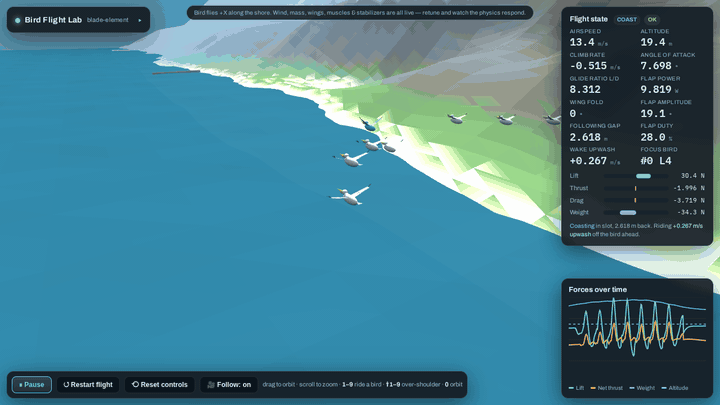
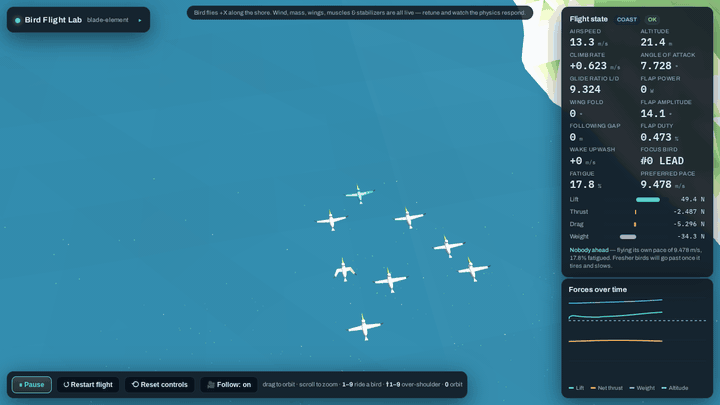
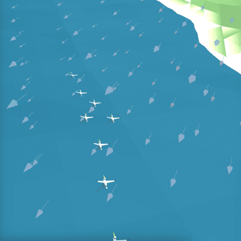

# Bird Flocking Lab

<p align="center">
  <a href="https://willkessler.github.io/bird_flocking_lab/"></a>
</p>

<h2 align="center"><a href="https://willkessler.github.io/bird_flocking_lab/">▶ TRY IT OUT: run the live lab in your browser</a></h2>

<p align="center"><i>Nothing to install. It opens straight into a flying flock. Drag to orbit, press 1–9 to ride a bird.</i></p>

[](https://willkessler.github.io/bird_flocking_lab/)

A browser-based physics lab for studying how **pelican flocks** fly: how individual birds generate thrust from flapping, how they save energy by drafting off one another, and how formations like the V form, hold together, and reorganize.

The whole lab is a single self-contained HTML file built on [three.js](https://threejs.org/). [Run it live](https://willkessler.github.io/bird_flocking_lab/), or open `index.html` locally in any browser; nothing needs installing.

## Why this exists

This is the latest of several attempts I've made over the years to simulate bird flight. Earlier pieces: [pelicans](https://github.com/willkessler/pelicans), a Processing flocking sim, and [springs_and_arms](https://github.com/willkessler/springs_and_arms), a workbench for articulated wing joints.

Classic [Boids](https://en.wikipedia.org/wiki/Boids) gets you convincing flocks from three local rules, but it cheats on the thing that matters most for formation flight: **propulsion**. A boid can step on the gas whenever it likes. A real bird has to pay for every bit of speed and every turn with muscle work, and that cost is the whole reason pelicans and geese fly in Vs: a bird sitting in the wingtip upwash of the bird ahead flies more cheaply.

So the goal here is to build the flock up from honest single-bird physics:

1. **Thrust has to come from the wing motion.** It isn't added as a force.
2. **Drafting has to come from a wake model.** The benefit of flying behind another bird should follow from the physics.
3. **Formation behavior should emerge from individual birds** responding to their own state (fatigue, airflow, neighbors) rather than from a choreographer placing birds in slots.

## What's simulated

**Single-bird aerodynamics (blade-element / strip theory)**
- Each wing is an **articulated two-segment** limb (inner arm plus outer hand) split into spanwise strips. Each strip computes its own local airflow (body motion, rotation, flapping velocity, wind, and wake) and its own lift and drag.
- Forward thrust **emerges** from the plunging downstroke (the Knoller–Betz effect). The wing **folds** at the elbow and wrist on the upstroke, which cuts upstroke drag and inertia.
- Per-segment angle of attack, feathering, wingtip-feather splay, and ground effect.
- **Muscle-driven mode:** the pectoralis and supracoracoideus are torque-limited by strength, length–tension, and Hill force–velocity curves. A bird that is too weak, or one with a rigid wing, can't sustain its wingbeat.
- Mass and bone thickness, head/tail mass distribution, a tail stabilizer, and active pitch/roll stabilization reflexes. Set the reflex gain to 0 to see the raw phugoid.

**Flock**
- **Self-organizing formation:** no slots, arms, or assigned leader. Each bird follows a handful of local rules (see [How the formation emerges](#how-the-formation-emerges-v13)).
- **Wingtip-vortex wake model:** a bird outboard of the tip of the bird ahead gets upwash (a lift bonus), and a bird inboard of it gets downwash. Near the water, mirror-image vortices partly cancel it.
- **Momentum slipstream:** directly behind another bird is a low-drag channel of co-moving air.
- **Intermittent flap-and-glide flight:** each bird decides beat by beat whether to flap or coast.
- **Surface skimming:** the flock periodically drops to ride ground effect just above the water, as pelicans do working a surf line.
- **Fatigue:** flapping harder than a bird's sustainable power builds fatigue, which weakens its flight muscles and lowers the pace it wants to fly. Birds differ in fitness and preferred pace.
- Coastline following, gusty turbulent wind, and headwind and crosswind.

**Viewing:** orbit camera, `1`–`9` to ride a bird's-eye view, `Shift`+`1`–`9` for an over-the-shoulder chase cam (drag to look around), and live telemetry and force charts for the focused bird.

## Repository layout

| Path | What |
|---|---|
| `index.html` | The current version of the lab (v19; the version shows next to the title in the lab's panel), which is where iteration happens |
| `versions/` | Every earlier build, kept for reference (see below) |
| `docs/conversation-notes.md` | Notes from the design conversation that produced v1 through v12 |
| `docs/next-steps.md` | Where the investigation stands (V vs single file) and the experiments to try next |
| `tools/flock-metrics/` | Headless harness that runs the flock physics and measures emergent structure |
| `media/` | README assets |

### Version history (`versions/`)

There are two naming series, in chronological order:

- `bird-sim.html`, `bird-sim_1` … `bird-sim_10` (Aug–Sep 2026): the single-bird lab. These cover the blade-element aero, the feathering fix, active stabilization, the articulated folding wing, and the torque-limited muscle model. `_4`, `_5`, and `_6` are identical snapshots.
- `bird-sim-v2` … `bird-sim-v12` (Sep 2026): the multi-bird flock. These add the wake and drafting model, V formation, lead rotation, flap-and-glide station keeping, coastline following, surface skims, turbulence, and camera modes. In these versions the V is choreographed: fixed slots, fixed arms, and a timed round-robin lead swap.
- `bird-sim-v13` (Nov 2026): the choreography is removed, and formation and leadership emerge from local rules. Larger flocks tend to fill in as diamonds.
- `bird-sim-v14` (Nov 2026): adds the clear-view rule, so boxed-in birds work their way out to the arms and Vs form on their own.
- `bird-sim-v15` (Nov 2026): trailing vortices sink behind each bird, and followers may settle up to 1.5 m above or below the flock at whichever height feels more upwash.
- `bird-sim-v16` (Nov 2026): the flock can skim as low as 0.4 m without hitting the water (shallower wingbeats near the surface, tighter height-holding), and a seventh rule, *follow*, lets single-file strings form when the wake fades. 20 birds by default, and the version is shown in the panel.
- `bird-sim-v17` (Nov 2026): rule 2 now chooses a *spot* (an open wingtip spot or the spot straight behind a bird) by the air expected there, instead of following the nearest bird ahead. Arms stay closer to one bird wide, and an eighth rule, *same side*, breaks ties.
- `bird-sim-v18` (Nov 2026): followers pace off the next birds up their line, not just the one ahead (*look up the line*). Birds keep personal space and give way when about to cut across each other. Split-off birds work to rejoin the flock. Birds avoid the jetties and hills. Wakes rise in steady updrafts. Each bird has its own quirks.
- `bird-sim-v19` (Nov 2026): seeded runs for repeatable experiments, a *Join one at a time* start, a *Cost of overtaking to a spot* slider (off by default), and a rejoin rule so a group that has fallen behind merges back into the flock. Wind vectors are off by default. This is the same as the current `index.html`.

## How the formation emerges (v13–v18)



*Time-lapse at about 6× speed, starting from a loose random cluster. The bird at the point is tinted blue.*

Up to v12, the V was choreographed. Each bird was assigned a slot (`rank × spacing`) on a fixed arm and held there by a lateral force, and every 16 s the lead was sent to the back in strict rotation. Measured headlessly, v12 was a V 98–100% of the time under every setting tried.

From v13 on, nothing is assigned. Each bird only knows what it can see (birds ahead of and beside it), what it can feel (the air on each wing, its own speed), and its own state (fatigue, fitness, preferred pace). It follows these rules:

1. **Pace:** fly at my preferred speed, which drops as I tire.
2. **Draft:** if a bird is ahead of me, pick a spot to fly in: off the left wingtip, off the right wingtip, or straight behind one of the nearby birds, judged by the rising air I'd expect there, less how far away it is. A spot another bird already holds doesn't count. If nothing decent is open ahead, I also consider spots behind settled birds beside or behind me, and ease back down the formation to reach one. If no bird is ahead, I'm leading: follow the coast at my own pace, easing off if the flock behind me falls away. (Up to v16 this rule was "follow the nearest bird ahead", which let birds settle inside the V and grow second lines off the middle of an arm.)
3. **Seek air:** slide sideways toward whichever wing feels more rising air or less drag. This is the roll a bird feels when one wing is in upwash. Since v15, a follower also drifts up or down, within 1.5 m of the flock's height, toward whichever height feels more upwash.
4. **Space:** don't overlap a bird alongside me. Since v18, each bird also keeps some clear air around itself (*Personal space*, 1 m beyond the wingtips by default) and gives way, like the separation rule in Boids but looking a moment ahead. It projects each neighbour's motion up to 1.5 s forward, and if the two would come inside each other's space, the bird *behind* yields: it holds back, slides off sideways, and steps up or down. When they're level, the one sliding across yields. Birds well above or below each other don't conflict, so a line can stay tight by staggering in height.
5. **Pass:** if the bird I'm drafting keeps flying slower than I want to go, pull out and go past it.
6. **Clear view** (added in v14): if there are birds ahead of me on *both* sides, I'm boxed in, so drift toward the less crowded side and ease back a rank until one side opens up. This is the "visual" hypothesis for V formations: each bird keeps an unobstructed view forward on at least one side.
7. **Follow** (added in v16): prefer the spot straight behind a bird a little (the *Follow the bird ahead* slider, in m/s of upwash). Next to the wake's upwash that preference is small, so where there's a wake to ride, the wake wins. Where the wake fades, as when skimming low over the water, it decides, and the flock strings out.
8. **Same side** (added in v17): if the bird ahead of me sits to the left of the bird it follows, and the left and right spots behind it are about equally good, take the left one (and likewise right). This was a suggestion from watching real pelicans. It turns out the wake already makes this choice almost everywhere: behind a bird on an arm, the same-side spot has about 1.5 m/s more upwash than the other side, which sits behind the bird two places ahead, in its downwash. So the preference (0.15 m/s by default) only decides where the air is nearly even, and it changes the measurements less than they vary from run to run.
9. **Look up the line** (added in v18): a follower paces itself partly off the next one or two birds up its line (their speed, and whether it's the right number of gaps behind them), not only the bird directly ahead. Matching only the bird ahead, every surge and lag grows as it passes back down a long line (an accordion). Station error grew from 0.6 m at the front of a 20-bird V to 2 m at the tail, and the tail birds burned more power than the leader chasing it, tired, and fell off.
10. **Stay with the flock** (added in v18): a bird with nobody close ahead that can still see birds further ahead steers toward them and flies a little faster. A bird leading with a big hole somewhere behind it eases off so the stragglers can close.
11. **Avoid obstacles** (added in v18): look along my track up to 5 s ahead, under my body and both wingtips. If a jetty or rising ground comes within about 1.5 m of my height, climb to clear it, and if it's a hillside, also turn toward the lower ground beside it. In an onshore wind the leader now crabs into the wind (up to about 23°) to hold its line along the shore. Before v18, birds flew straight through the jetties and hills.

**Quirks** (added in v18): no two birds choose alike. Each has its own preferred follow distance (±9% by default) and reach out past the wingtip of the bird ahead, leans slightly to a favourite side and height, dithers or decides quickly, and now and then picks a slightly worse spot. The *Individual quirks* slider scales all of it, and 0 gives identical birds and a mechanically perfect V.

"Lead rotation" falls out of these rules plus the physics. Breaking clean air costs more than riding a wake, so whoever is in front tires, slows down, and gets passed by fresher birds, then drops into someone's wake to recover. Several tired birds can drift back together, and which bird takes the point depends on fitness, fatigue, and position.

### What the measurements show

Results come from `tools/flock-metrics` over 300–400 simulated seconds per run. They vary from run to run because each run starts from a different random cluster.

| | v12 (choreographed) | v13 (rules 1–5) | v14 (rules 1–6) | v15 (+ sinking wake, height freedom) |
|---|---|---|---|---|
| Shape, 12 birds | V 98–100% | **Diamond / filled 23–94%**, V 0–40% | V 49–97%, filled 1–27%, the rest mixed | V 72–94%, filled 6–12% |
| Shape, 8 birds | V 98–100% | V 23–65%, filled 5–46% | V 59–90%, filled 3–9% | V 81–100%, filled 0–3% |
| Interior birds (birds ahead on both sides), 12 birds | n/a | 9–28% | 5–9% | 3–5% |
| Lead changes per 300 s | Every 16 s, on a timer | 2–18, decided by the birds | 2–15, decided by the birds | 3–10, decided by the birds |
| Power: leading vs drafting (calm air) | 62 W vs 49 W | 67 W vs 48 W | 69 W vs 55 W | 68–70 W vs 47–51 W |

Most of those V's are lopsided. Counting a V as lopsided when one arm is at least twice the other plus one, or 3+ birds longer, v14 flew lopsided V's 51–59% of the time with 8 birds and 44–79% with 12. In v15 it varies more from run to run: 3–80% with 8 birds and 18–83% with 12. Pure echelons (all followers on one side) also appear, and a crosswind pushes strongly toward both (see below).

Two ablations: with passing switched off, one bird holds the point for the whole run, and with air-seeking switched off, birds stop finding the upwash and the flock sprawls.

The first published v13 numbers overstated how often it flew Vs. The shape metric then called *any* flock with birds on both sides of the leader a V, so diamonds were counted as Vs. The metric now detects filled formations separately; the figures above use it.

### Findings worth knowing

- **Crosswind makes lopsided V's and echelons on its own, but the flock copes badly with it.** With a 3 m/s crosswind, 12 birds fly balanced V's only 3–5% of the time, lopsided ones 64–69%, and echelons 26–33%. No rule mentions the wind: it skews the wakes, and the birds seeking better air follow them. However, from 1.5 m/s of crosswind up, drafting costs *more* than leading (65–77 W vs 32–46 W) and the flock can stretch out to 80–290 m. This is an open issue, present since v14, and its cause isn't diagnosed yet.
- **Diamonds are a local optimum, not a good place to be.** Without the clear-view rule, a bird boxed in between two others sits in their combined downwash. It gets about 0.1 m/s of upwash, against about 0.5 m/s for a bird on an arm, and needs about 25% more flap power. Air-seeking alone can't get it out: feeling the air only tells it which way is *locally* better, and the better air is several ranks back at the end of an arm. A simple visual rule ("don't be boxed in") is enough to turn diamonds into Vs, and its strength (the *Keep a clear view* slider) sweeps the flock from diamond through mixed to V.
- **Turbulence decides whether formation flight pays.** Above about 1.5 m/s of gusting, followers burn their drafting savings chasing the bird ahead through air that hits each bird differently. Drafting then costs *more* than leading, and fatigue no longer drives who leads. This matches field observations that formation benefits shrink in rough air. The default turbulence is 1.0 (v12 used 2.5).
- **Up high, single-file strings don't emerge, and the wake field shows why.** Directly behind another bird is a stable but *narrow and poor* spot. A bird nudged a little sideways is pushed back into line, but the pocket is only about ±0.2 m wide, and it sits in deep downwash right next to a strong upwash niche. Ordinary wobble knocks a bird out of line and it slides into the niche, which is why flocks form echelons and V's, and why geese don't fly in columns. In 12-bird runs up to v15, strings of 3+ birds appear 0–2% of the time under every condition tried. The sinking wake and height freedom (v15) don't change this; if anything they make V's more stable. Wave-slope updrafts along swell crests were also tested and removed. What *does* change it is the water. Computing the wake field directly shows how the in-line pocket depends on altitude and spacing:

  | Altitude | Spacing | In-line pocket | Downwash in line | Upwash in V niche |
  |---|---|---|---|---|
  | 20 m (cruise) | 2.5 m | ±0.19 m | −1.85 m/s | +0.98 m/s |
  | 2 m (current skim) | 2.5 m | ±0.19 m | −1.73 m/s | +1.07 m/s |
  | 0.5 m | 2.5 m | ±0.34 m | −0.75 m/s | +1.00 m/s |
  | 0.5 m | 10 m | ±2 m (everywhere) | −0.01 m/s | +0.01 m/s |

  Skimming at about half a meter with loose spacing, the wakes' mirror images below the surface cancel them almost completely. There's then no penalty for flying directly behind and nothing to gain by staggering, so birds following the bird ahead would stay in line. That matches brown pelicans flying long, loose single-file lines with their wingtips nearly touching the waves. v15 couldn't fly that low (full 35° wingbeats dip the wingtips into the sea); v16 can, and strings do form there (next finding).
- **Strings form when the flock skims low with loose spacing (v16).** Making a 0.5 m skim safe took three fixes: the wingbeat gets shallower near the surface so the tips stay about 0.2 m clear; height-holding firms up near the water and tracks the dive rate instead of fighting it; and a slow lift correction stops gliding birds sagging toward the water. Bodies no longer touch the water, though wingtips still brush it for well under 1% of skim time. Strings still need the *follow* rule pulling harder than the wake (12 birds, 20 s skims):

  | Skim height | Follow distance | Follow strength | 3+ birds in line, % of skim time |
  |---|---|---|---|
  | 0.5 m | 8 m | 0.3 | 18, 7, 32 (strings up to 7 birds long) |
  | 2.0 m | 8 m | 0.3 | 7, 6, 2 |
  | 0.5 m | 8 m | 0.15 | 2, 7 |
  | 0.5 m | 2.5 m | 0.15 | 4 |

  So the water roughly quadruples string-forming, as the wake field predicted. (These are v16 numbers; v17's spot rule weakens the effect, see below.) At cruise height the same follow strength (0.3) breaks up the V's, and drafting 8 m back costs more than leading. The default follow strength is 0.15, which leaves cruise formations to the wake. It does shift the default 8-bird flock from mostly V's toward a mix of V's and echelons (V 35–96% of the time across three runs, against 69–100% with the rule off). To watch strings form, set *Skim altitude* to 0.5 m, *Target follow distance* to 8 m and *Follow the bird ahead* to 0.3.

  

- **Arms one bird wide (v17).** In photos of real pelican flocks, each arm of a V is a single straight line with nothing inside the V. Up to v16, large sim flocks grew second lines beside an arm and short V's off its tail. The cause was rule 2: a bird squeezed in near the front or inside the V followed the nearest bird ahead, and every open spot ahead of it was in downwash, so it settled there and others lined up behind it. Choosing spots by expected air, and easing back to an arm's end when nothing good is open ahead, fixes most of this. With 8–12 birds, a second line splits off an arm 19–39% of the time, against 33–79% in v16, and the flock averages 2.3–2.9 arm ends (a clean V has 2). With 20 birds it still averages 3.3–4.3 arm ends, and a long arm can hook outward near its tail. v17 also has two regressions: the low-skim strings are weaker (3–8% of skim time, against 7–32% in v16), and birds pass closer to each other (closest pair 0.5–0.8 m, against about 1.1 m). Making the wakes last longer (decay 45–80 m instead of 22 m) didn't change the branching.
- **v18: spacing, cohesion and quirks.** Against v17, with 20 birds and one or three runs per case:
  - **Default:** V's 96% of the time (43% in one v17 run), closest pair 1.15 m (0.84 m), and drafting costs 47 W (57 W).
  - **Gusty air** (turbulence 2.5): V's 82–100% of the time against 75–94%, and the flock splits 1–5% of the time against 6–19%.
  - **Onshore crosswind** (3 m/s): the flock is over land 15% of the time instead of 89%, and the closest any bird gets to the ground is 0.4–0.9 m. In v17, birds flew 1.5 m deep into the hillside.
  - **Downside:** with quirks, a second line branches off an arm more often (50–74% of the time at 12 birds, against 34–46%).
  - **Strings:** single-file strings are still rare at cruise height.
- **Updrafts lift the wake.** A wingtip vortex pair sinks at about 0.6 m/s through the air around it, by mutual induction (it isn't buoyancy). In rising air the wake rises with the air, so in lift stronger than about 0.6 m/s the best air is slightly *above* the bird ahead. Since v18 the wake rides the steady *Updraft* setting. At the default 2.5 m spacing that only moves the wake about 0.2 m by the time it reaches the next bird, so the effect is small. In a 1.5 m/s updraft, v17's followers sank to 0.23 m below the bird ahead (0.09 m in still air), following a wake that should have risen. v18's followers stay about 0.1 m below in both cases, and drafting in the updraft costs 15 W against 24 W. That's one run each, and the vertical stagger seen at Chrissy Field is larger than this, so updrafts alone probably don't explain it. Brief gusts are left out: they move the birds about as much as their wakes. Letting gusts carry the wake broke up the V in gusty air (V's 15–42% of the time).
- **v19: what makes a V lopsided.** Real V's often have one long arm and one short one (13 birds against 5 in one Chrissy Field photo, a long-arm share of 0.72). Join order alone doesn't do it: birds that join one at a time end up as balanced as a random cluster (long-arm share about 0.6). A cost for overtaking to reach a spot does: at 0.15–0.25 m/s per 10 m, V's reach 0.72 from either start. Only when the cost is strong (0.5) does join order decide the arm (91–99% of joiners take the side of the bird before them), and then the flock mostly forms echelons. The cost stays off by default because it also makes birds hang back rather than close up, and the flock splits. See `docs/next-steps.md`.
- **Calm air alone doesn't produce strings at cruise height.** Pelicans in very calm air are often seen flying mostly single file, each bird a little above or below the one ahead. In the sim, 20 birds with no wind and almost no turbulence still fly V's 89–94% of the time (99% in the default gusty air), so wind isn't what makes the V's. The few in-line pairs that do form sit 1.5–2 m above or below the bird ahead, which is the vertical offset seen in the field. With a much stronger follow pull (0.45), strings of 3+ appear 24% of the time in calm air, but drafting then costs more than leading. So either real birds in those lines are near the water's ground effect, or they aren't drafting for aerodynamic gain. This is an open question.
- **Some individuals stay tired.** Less-fit birds can sit near full fatigue even while drafting. That may be realistic, or it may mean the tail of an echelon doesn't pay enough.

## Running the metrics harness

```sh
tools/flock-metrics/run.sh                      # index.html with specs/default.json
tools/flock-metrics/run.sh versions/bird-sim-v12.html my-spec.json
```

It requires Docker and runs in the `mcr.microsoft.com/playwright` image. A spec is a JSON list of runs, `{"name", "secs", "P": {parameter overrides}, "timeline": N}`. The harness steps the physics directly with no rendering, so 300 simulated seconds take about 5 s.

## License

[MIT](LICENSE). This is an open, experimental project. If you're studying formation flight, flapping propulsion, or emergent collective behavior, you're welcome to use it, fork it, and build on it.
