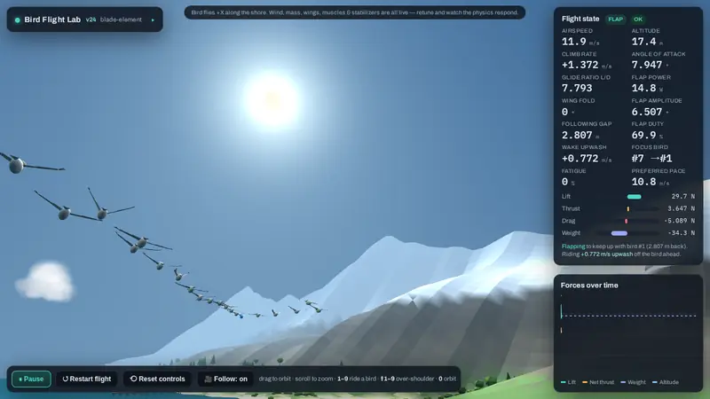

# Bird Flocking Lab

<p align="center">
  <a href="https://willkessler.github.io/bird_flocking_lab/"></a>
</p>

<h2 align="center"><a href="https://willkessler.github.io/bird_flocking_lab/">▶ TRY IT OUT: run the live lab in your browser</a></h2>

<p align="center"><i>Nothing to install. It opens straight into a flying flock. Drag to orbit, press 1–9 to ride a bird.</i></p>

[](https://willkessler.github.io/bird_flocking_lab/)

A browser-based physics lab for studying how **pelican flocks** fly: how individual birds generate thrust from flapping, how they save energy by drafting off one another, and how formations like the V form, hold together, and reorganize.

The whole lab is a single self-contained HTML file built on [three.js](https://threejs.org/). [Run it live](https://willkessler.github.io/bird_flocking_lab/), or open `index.html` locally in any browser; nothing needs installing.

## Why this exists

This is the latest of several attempts I've made over the years to simulate bird flight. Earlier pieces: [pelicans](https://github.com/willkessler/pelicans), a Processing flocking sim, and [springs_and_arms](https://github.com/willkessler/springs_and_arms), a workbench for articulated wing joints.

Classic [Boids](https://en.wikipedia.org/wiki/Boids) gets you convincing flocks from three local rules, but it cheats on the thing that matters most for formation flight: **propulsion**. A boid can step on the gas whenever it likes. A real bird has to pay for every bit of speed and every turn with muscle work, and that cost is the whole reason pelicans and geese fly in Vs: a bird sitting in the wingtip upwash of the bird ahead flies more cheaply.

So the goal here is to build the flock up from honest single-bird physics:

1. **Thrust has to come from the wing motion.** It isn't added as a force.
2. **Drafting has to come from a wake model.** The benefit of flying behind another bird should follow from the physics.
3. **Formation behavior should emerge from individual birds** responding to their own state (fatigue, airflow, neighbors) rather than from a choreographer placing birds in slots.

## What's simulated

**Single-bird aerodynamics (blade-element / strip theory)**
- Each wing is an **articulated two-segment** limb (inner arm plus outer hand) split into spanwise strips. Each strip computes its own local airflow (body motion, rotation, flapping velocity, wind, and wake) and its own lift and drag.
- Forward thrust **emerges** from the plunging downstroke (the Knoller–Betz effect). The wing **folds** at the elbow and wrist on the upstroke, which cuts upstroke drag and inertia.
- Per-segment angle of attack, feathering, wingtip-feather splay, and ground effect.
- **Muscle-driven mode:** the pectoralis and supracoracoideus are torque-limited by strength, length–tension, and Hill force–velocity curves. A bird that is too weak, or one with a rigid wing, can't sustain its wingbeat.
- Mass and bone thickness, head/tail mass distribution, a tail stabilizer, and active pitch/roll stabilization reflexes. Set the reflex gain to 0 to see the raw phugoid.

**Flock**
- **Self-organizing formation:** no slots, arms, or assigned leader. Each bird follows a handful of local rules (see [How the formation emerges](#how-the-formation-emerges-v13)).
- **Wingtip-vortex wake model:** a bird outboard of the tip of the bird ahead gets upwash (a lift bonus), and a bird inboard of it gets downwash. Near the water, mirror-image vortices partly cancel it.
- **Momentum slipstream:** directly behind another bird is a low-drag channel of co-moving air.
- **Intermittent flap-and-glide flight:** each bird decides beat by beat whether to flap or coast.
- **Surface skimming:** the flock periodically drops to ride ground effect just above the water, as pelicans do working a surf line.
- **Fatigue:** flapping harder than a bird's sustainable power builds fatigue, which weakens its flight muscles and lowers the pace it wants to fly. Birds differ in fitness and preferred pace.
- Coastline following, gusty turbulent wind, and headwind and crosswind.

**Fishing (v23)**
- **Fish schools** show up on the water: a dark patch over a bait ball, silver fish milling and jumping, small boils at the surface, a ring, and a label with how many fish are left and how many pelicans are working it. They turn up ahead of the flock on their own, or you can click the water to drop one.
- **Going fishing:** a bird hungrier than 40% that sees a school within 150 m, or sees another bird fishing one, leaves the flock. A yellow line shows what it spotted. It circles about 13 m up in a left-hand orbit, then turns in and lines up a dive, aiming off to one side because its roll-in carries it left. Each bird learns where its own dives land.
- **The plunge dive:** it rolls left past vertical and pulls its nose down, sweeps its wings back and lifts them into a V over its back, then folds them flat in the last couple of metres and hits the water as an arrow. The tuck changes the real wing geometry in the aero model, so the lift genuinely goes away and the fall is ballistic. Dives from about 13 m hit the water at about 16.5 m/s (37 mph), 60–80° steep, close to the PBS footage (40 mph from about 40 ft).
- **In the water:** the impact makes it gulp air into its air sacs, so it pops back up within about a second from about 1 m down. Then it drains its pouch (bill down), swallows (head back), and bobs facing into the wind.
- **Takeoff from the water:** it flaps hard with the beat raised and runs on the surface with its feet, until its wings carry enough to break the water's grip. That takes about 3 s (2–4 s) and 11–30 m, lifting off at about 9–12 m/s.
- **Full** (hunger below 25%; birds start with different appetites, so it takes 1–3 fish), it stops fishing and climbs back up to the flock, even while others are still at it, so the flock breaks up. Hunger slowly comes back.

**Fishing (v24)**
- **Scouting:** a bird that finds a new school circles it for a couple of laps (1.5–2.5, the *Scouting laps* slider) before its first dive.
- **Pods:** a school is 5–8 pods of fish milling inside it. Each pod comes up to feed at the surface (silver fish, boiling water) for 8–18 s, then sinks out of reach (a dim blue glint) for 4–12 s.
- **Diving on a chance:** a circling bird turns in only when a pod is up at the surface ahead of it and inside its turn. It prefers pods that have just come up, and leads the pod by where it will be at impact. While it lines up and dives it has that pod to itself for a couple of seconds. The strike scares the pod down, and if the pod sinks while a bird lines up, the bird goes round again. So the dives come one at a time as the fish show, and about 3 in 4 land a fish.
- **On the water**, each bird faces its own way and paddles slowly about, then takes off roughly into the wind.
- **Scenery:** timber piers on pilings with planked decks and railings, groves of trees and bushes along the shore, a sun in the sky (ahead of the flock, about 40° up; the bird shadows on the sea are cast from it), and fair-weather cumulus clouds.

**Coming and going (v25):** the flock isn't a closed club. About every 45 s a bird drops out (never the lead, and never from a flock of 6 or fewer). Three in four glide down to rest on the water beside a pier or just off the beach; the rest head off out to sea. Birds resting along the coast ahead (two at the start) take off and tag on when a flock passes, after resting at least 20 s. A bird left out of sight behind comes back as a fresh bird resting somewhere ahead. So the flock grows and shrinks. *Birds come and go* turns it off; with it off, seeded runs replay v24 exactly.

**The coast (v25):** the sea has sharper wave crests with flat troughs, whitecaps on the highest crests, swell that steepens and breaks into lines of white water as it rolls toward the beach, foam running up the sand, and paler shallows. Lifeguard towers stand on the beach and boats (sailboats and small fishing boats) ride at anchor 100–200 m offshore, well clear of the flock.

**Different birds, the cliffs and a calmer camera (v29):** the birds are no longer clones. Males run about 3% longer and 10% heavier than females, every bird differs a little more (about ±6% in wingspan and ±18% in weight overall), and about one bird in seven is a first-year bird: grey-brown all over, a bit smaller and lighter. Size goes into the physics: a bird scaled up in length gets wings bigger by the square but weighs more by the cube, so big birds carry more weight on each square metre of wing, beat their wings a little slower, and shed stronger, wider wakes; slots in the V sit half of each neighbour's wake-span apart. *Size differences* and *Young birds* set how much (0 = identical birds). At cruise height, followers now take their rhythm from the bird ahead: each starts flapping about where it started and glides where it glided, so a wave of wingbeats runs back down the line, and it only beats harder or softer to keep its place (sitting a burst out when it's already ahead, breaking rhythm only when it falls 2 m or more out of place). Followers flap less, and their drafting costs less power. With an onshore breeze (*Sea breeze on the bluffs*), the air rising over the cliff edge is a band of ridge lift. Every couple of minutes (*Cliff visits every*) the flock swings in low toward the cliffs, lets the lift carry it up to the height where the rising air just about matches a gliding pelican's sink, and glides along the edge in a V narrowed to fit the lift band, mostly on outstretched wings; then it swings back out and comes down to the sea. Fishing and surface skims wait until it's back. Ground effect now only acts over the water. Two hang gliders fly the same lift along the cliffs, sinking through the air and carried up by the lift, holding a smoothed line along the edge and making an occasional U-turn out to sea. The camera now watches the middle of the flock rather than its lead (*Camera watches the middle of the flock*), so a change of lead no longer swings the view; pick a bird and it follows that bird as before. That middle is smoothed: birds fade in and out of it over a few seconds as they leave or rejoin the flock, and the aim moves with the flock and settles on a soft spring, so it never catches up in lurches. The wings are drawn as if they had mass: each joint follows the physics on a stiff spring, so the elbow opening at the top of the stroke, a burst starting, or a change to takeoff, circling or a dive is a quick smooth swing, not a one-frame snap. The bank is drawn the same way: a bird rolls into and out of its turns over about a quarter of a second instead of jumping 20–30° in a frame, and its tail twists along its length to help the roll (the physics itself is unchanged).

**A steadier lead keeps the cruising V (v31):** the V formed every time the flock came down to skim the water or climbed, but came apart whenever it went back to cruising. The cause was the lead's easy-cruise flap-and-glide: it beat hard until it was about 0.4 m/s over its pace, then glided until it was 0.75 m/s under, so its speed surged and sagged. Each surge ran down the arms like an accordion, so gaps opened and closed and birds overran into the middle of the V. (Climbing and skimming, the lead's speed is steady, which is why the V held there.) The lead now flaps and glides in a short, gentle cycle (from 0.2 m/s under its pace to 0.1 m/s over, with moderate beats), while the followers still take their rhythm from the bird ahead. Measured from 15 s after cruise resumes, the flock collapsed out of the V 14 to 35% of the time instead of 32 to 71%. Followers rode more upwash (about 0.5 m/s instead of about 0.4) and used about 15% less power, though the lead itself flaps more of the time.

**Soaring the cliffs in a line (v30):** along the bluffs the flock no longer holds a V. In the ridge lift everyone is held up anyway, so riding a neighbour's wake matters little; what matters is staying close and in the band of lift, ready to go back to sea together. Once the flock has swung in to the cliffs, each bird simply follows the next bird up the line, a little to one side or the other as it likes, so the V strings out into a loose single-file line along the edge (as pelicans riding a ridge or the surf do), and opens back into a V over the sea. (Before, the V filled in to a diamond or a lattice for most of every visit.) The flock also flies the bluffs the way a bird saving energy would: its line is the cliff edge smoothed over about 120 m, so it coasts straight across coves, gullies and paths cut into the cliff instead of tracing every bend, and it holds one smooth height (the soaring height averaged over about 200 m of cliff, never less than about 8 m above the face under it) instead of climbing over every rise in the bluff and dropping into every dip. Climbing and sinking while soaring fell from about 2.5 m/s to 1 m/s. Leaving, it now glides out over the sea at soaring height first and only then lets down to the water in a long shallow glide; going down the face first had birds flying low past the bluff and climbing over its spurs.

**Days and weather (v29):** the sun rises behind the hills, crosses the southern sky and sets over the sea; a whole day takes *Length of a day* real minutes, and the night goes by faster, under stars and a moon. The weather comes in spells of a few minutes: mostly sunny (sometimes with a few clouds), coastal fog (more often in the morning and evening), a grey overcast, and occasionally rain. *Coastal fog and cloud* sets how often it isn't clear. A small icon in the top-right corner shows the current weather, and the time and weather are in the banner at the top. Walkers, dogs, surfers, hang gliders, dolphins and the whale are only out by day, each keeping its own hours. Walkers and hang gliders stay home in the rain, and hang gliders also stay down in thick fog. They come and go only while out of view, so nothing pops in or out in front of you. The birds fly day and night. Behind the bluffs the land levels out into a plateau of low rolling hills: gullies notch the cliff edge but fill in behind it. The plateau runs far inland, so its end is always lost in the haze. Each kind of bird has its own plumage: crows are black, swallows a dark glossy blue, albatrosses white with dark wings. *Joiners see the whole flock* is now on by default.

**Airflow lines and a tidier screen (v29):** *Airflow lines* (off by default) replace the old drifting dots. Short smoke-like streaks of air stream past the flock in its own frame, the air as the birds meet it, like the streamlines round a wing in a wind tunnel. They are carried by the breeze, gusts, ridge lift and every bird's wake, so they bend up beside a bird's wingtips, down in the wash behind it, and up over the cliff edge. The up-and-down part is drawn 3× larger than life, green where the air rises and red where it sinks. (The old dots never moved on screen: their positions were copied into the GPU buffer once at start-up.) All the panels now live in one panel down the left, which folds away to its title. Inside, a scrolling column holds *Controls*, *Flight state* and *Forces over time*, each folding on its own title, and all three start folded. The *Flight state* header says what the whole flock is doing: cruising, climbing, descending, in ground effect, heading to, soaring or leaving the cliffs, fishing, or on the water. Next to that it says whether most of the flock is flapping or gliding, and STALL if the bird in the panel stalls. The corner icons show what they do as soon as you hover over them.

**The sea and the coast (v28):** the far coast fades out into the sky instead of popping in and out as the view moves along it, and everything on it (boats, people, the shading of the sand and cliffs) is the same in every stretch, so nothing changes when the coast re-centres. Surfers wait in the lineup beyond the breakers and now and then paddle for a wave and ride it in; a pod of dolphins porpoises along the coast; a grey whale surfaces now and then with a misty blow, and every other time shows its flukes as it dives. The sea no longer looks like a tiled grid: the facets are irregular, the swell comes from five directions in slow-moving groups, and far water evens out under a faint haze. *Easy cruising* (on by default): at cruise height the lead flaps hard up to a little over its pace, then glides, sinking up to 3 m, until it is a little under it; each follower rises and falls with the bird it follows, so a gentle wave runs down the line. The *Airflow* dots no longer leave a stranded block of dots behind.

**People on the beach (v27):** a few people walk the firm sand by the water, some with a dog running about them, and a few stand looking out to sea. They give a sense of scale: a pelican's wings span more than a person is tall. The pelicans' rumps now taper smoothly into the tail instead of ending in a flat cut, and their eyes are larger: a pale iris with a dark pupil, set in a patch of bare pinkish skin.

**The bird and the coast (v26):** the pelicans have proper bodies: a deep, broad body with a full breast and a short fanned tail, the wings growing out of the back; the neck and head are one smooth piece, rising out of the breast, folded back in an S so the head rides on the shoulders, with the eyes set into the head and the long flat bill with its pouch slung underneath. Flapping is smoother (*Smooth flap-and-glide*, on by default): a burst starts with a downstroke and grows into the beat, lasts at least two beats (one when skimming), and fades out onto the glide angle instead of snapping to it; the hand hangs below the raised arm on the upstroke and sweeps on down past it on the downstroke. The coast is modelled on Fort Funston in San Francisco: a dark sand beach backed by sheer sandstone bluffs 25–55 m high, fluted by runnels and banded with pale strata, cut by the odd gully, with ice plant, scrub and wind-shaped cypress on top and low hills rolling away inland. No more snow-capped peaks at the waterline. A bird that takes off to join a passing flock now goes as the front of the flock reaches it, so it falls in among them instead of out in front; the lead is always a bird that others are following, and a bird that has only just joined can't take it for 30 s. The camera glides to a new lead instead of jumping, and starts far enough back to show the flock.

**Sound (v25):** off until you click the speaker icon (top right) or press `M`; hover it for a volume slider. Everything is synthesized in the browser: wind that roars with the airspeed of the bird you ride or chase, a whoosh with each wingbeat (nearby birds panned to where they are), splashes when birds dive (and a soft patter when they run to take off), and surf that gets louder near the shore. Under water it all goes dull.

**Viewing:** orbit camera on the lead bird (it switches when the lead changes hands, and sits centred in the clear space between the side panels), `[` `]` to watch another bird, `1`–`9` to ride a bird's-eye view, `Shift`+`1`–`9` for an over-the-shoulder chase cam (drag to look around), `0` back to the lead, `F` for full screen, and a *Follow* checkbox to park the camera (it picks the flock up again once the flock is out of sight). Live telemetry and force charts for the focused bird. A GitHub icon in the top right links back here.

## Repository layout

| Path | What |
|---|---|
| `index.html` | The current version of the lab (v31; the version shows next to the title in the lab's panel), which is where iteration happens |
| `versions/` | Every earlier build, kept for reference (see below) |
| `docs/conversation-notes.md` | Notes from the design conversation that produced v1 through v12 |
| `docs/next-steps.md` | Where the investigation stands (V vs single file) and the experiments to try next |
| `tools/flock-metrics/` | Headless harness that runs the flock physics and measures emergent structure |
| `media/` | README assets |

### Version history (`versions/`)

There are two naming series, in chronological order:

- `bird-sim.html`, `bird-sim_1` … `bird-sim_10` (Aug–Sep 2026): the single-bird lab. These cover the blade-element aero, the feathering fix, active stabilization, the articulated folding wing, and the torque-limited muscle model. `_4`, `_5`, and `_6` are identical snapshots.
- `bird-sim-v2` … `bird-sim-v12` (Sep 2026): the multi-bird flock. These add the wake and drafting model, V formation, lead rotation, flap-and-glide station keeping, coastline following, surface skims, turbulence, and camera modes. In these versions the V is choreographed: fixed slots, fixed arms, and a timed round-robin lead swap.
- `bird-sim-v13` (Nov 2026): the choreography is removed, and formation and leadership emerge from local rules. Larger flocks tend to fill in as diamonds.
- `bird-sim-v14` (Nov 2026): adds the clear-view rule, so boxed-in birds work their way out to the arms and Vs form on their own.
- `bird-sim-v15` (Nov 2026): trailing vortices sink behind each bird, and followers may settle up to 1.5 m above or below the flock at whichever height feels more upwash.
- `bird-sim-v16` (Nov 2026): the flock can skim as low as 0.4 m without hitting the water (shallower wingbeats near the surface, tighter height-holding), and a seventh rule, *follow*, lets single-file strings form when the wake fades. 20 birds by default, and the version is shown in the panel.
- `bird-sim-v17` (Nov 2026): rule 2 now chooses a *spot* (an open wingtip spot or the spot straight behind a bird) by the air expected there, instead of following the nearest bird ahead. Arms stay closer to one bird wide, and an eighth rule, *same side*, breaks ties.
- `bird-sim-v18` (Nov 2026): followers pace off the next birds up their line, not just the one ahead (*look up the line*). Birds keep personal space and give way when about to cut across each other. Split-off birds work to rejoin the flock. Birds avoid the jetties and hills. Wakes rise in steady updrafts. Each bird has its own quirks.
- `bird-sim-v19` (Nov 2026): seeded runs for repeatable experiments, a *Join one at a time* start, a *Cost of overtaking to a spot* slider (off by default), and a rejoin rule so a group that has fallen behind merges back into the flock. Wind vectors are off by default.
- `bird-sim-v20` (Nov 2026): the overtaking cost now counts only birds passed on the way to a spot, so closing a gap is free and the flock stays together at any setting.
- `bird-sim-v21` (Nov 2026): *Finger of God* mode. Tick it and click near the flock to drop a sudden air pocket on it (a downdraft spreading outward), which knocks the birds nearby off course and startles them for up to a second. Up to 5 in a quick burst, then it recharges after 8 s without clicks. *Disturbance strength* and *size* sliders.
- `bird-sim-v22` (Nov 2026): two options for how a bird picks a spot, both off by default. *Joiners see the whole flock* widens its view from a narrow cone ahead (about 27° each side, 30 m) to about 70° each side and 60 m. *Energy cost of catching up* prices the distance to a spot from energy: the extra power to fly faster than the flock, plus the drafting lost on the way, spread over the 20 s the bird expects to hold the spot.
- `bird-sim-v23` (Nov 2026): fishing. Fish schools (automatic, or click the water to drop one), hungry birds that circle, plunge-dive with their wings really tucked, pop back up, drain and swallow, and run along the water to take off. A *Fishing lab* button sets up one hungry pelican and a school. With fishing off, seeded runs replay v22 exactly.
- `bird-sim-v24` (Nov 2026): fishing that looks like the real thing. Birds scout a school for a couple of laps, dive one at a time on pods of fish that come up to the surface, land about 3 dives in 4, and leave once full (so the flock breaks up). Swimming birds face their own ways. Real-looking piers, trees and bushes on the shore, a sun and clouds. Fixes a dotted-streak glitch (spent spray showed through the sea) and the clipped school label. With fishing off, seeded runs replay v23 exactly.
- `bird-sim-v25` (Nov 2026): birds come and go (they drop out to rest by a pier or the beach, or head out to sea, and resting birds join flocks going by), synthesized sound (off by default, with a volume slider), a livelier sea (sharp crests, whitecaps, breaking surf, foam at the waterline), lifeguard towers and boats at anchor, a GitHub link, `F` for full screen, a *Follow* checkbox, and a camera that stays on the lead. Fixes the view drifting off into empty sky with Follow off. With *Birds come and go* off, seeded runs replay v24 exactly.
- `bird-sim-v26` (Nov 2026): real pelican shapes (one smooth neck and head folded in an S, eyes set in, flat bill and pouch, full body with the wings on it, fanned tail), smooth flap-and-glide bursts with a bending wing, and Fort Funston-style sandstone bluffs instead of snowy peaks. Joiners fall in from the side or behind instead of stealing the lead, the lead is always a bird with followers, the camera glides between leads, and it starts back far enough to show the flock. With *Birds come and go* and *Smooth flap-and-glide* off, seeded runs still replay v24 exactly.
- `bird-sim-v27` (Nov 2026): people (some with dogs) walking and standing on the beach for scale; pelican rumps taper into the tail; larger, paler eyes set in bare skin. Seeded runs are unchanged.
- `bird-sim-v28` (Nov 2026): the far coast fades out instead of popping; surfers, dolphins and a grey whale; an irregular, grouped sea instead of a tiled one; *Easy cruising* (flap-glide with a gentle sink at cruise height); fixes the stranded *Airflow* dots. With *Birds come and go*, *Smooth flap-and-glide* and *Easy cruising* off, seeded runs still replay v24 exactly.
- `bird-sim-v29` (Nov 2026): birds of different sizes (males, females, young birds), with size in the physics; followers take their flap rhythm from the bird ahead; ridge lift along the cliffs, visits by the flock to soar it, and hang gliders flying it; ground effect only over water; a camera that watches the middle of the flock, smoothly; wings and banking drawn without snaps, with the tail twisting into a roll; day and night, and weather spells (fog, overcast, rare rain) with a weather icon; beach and sea life by day only; a rolling plateau behind the cliffs, running far inland; black crows (plumage per kind of bird); joiners see the whole flock by default; airflow drawn as streamlines past the flock; all panels in one folding panel on the left. With *Birds come and go*, *Smooth flap-and-glide*, *Easy cruising*, *Size differences*, *Young birds*, *Joiners see the whole flock* and cliff visits off (and no sea breeze), seeded runs still replay v24 exactly.
- `bird-sim-v30` (Nov 2026): soaring the cliffs in a loose single-file line instead of a V (which had filled in to a diamond), along a smoothed line at one smooth height, coasting over the gaps in the cliff; leaving, gliding out over the sea before coming down. With cliff visits off, seeded runs are unchanged from v29.
- `bird-sim-v31` (Nov 2026): the lead cruises with a short, gentle flap-and-glide so its speed stays steady, and the V holds when the flock goes back to cruising. With easy cruising off, seeded runs are unchanged from v30. This is the same as the current `index.html`.

## How the formation emerges (v13–v18)


*Time-lapse at about 6× speed, starting from a loose random cluster. The bird at the point is tinted blue.*

Up to v12, the V was choreographed. Each bird was assigned a slot (`rank × spacing`) on a fixed arm and held there by a lateral force, and every 16 s the lead was sent to the back in strict rotation. Measured headlessly, v12 was a V 98–100% of the time under every setting tried.

From v13 on, nothing is assigned. Each bird only knows what it can see (birds ahead of and beside it), what it can feel (the air on each wing, its own speed), and its own state (fatigue, fitness, preferred pace). It follows these rules:

1. **Pace:** fly at my preferred speed, which drops as I tire.
2. **Draft:** if a bird is ahead of me, pick a spot to fly in: off the left wingtip, off the right wingtip, or straight behind one of the nearby birds, judged by the rising air I'd expect there, less how far away it is. A spot another bird already holds doesn't count. If nothing decent is open ahead, I also consider spots behind settled birds beside or behind me, and ease back down the formation to reach one. If no bird is ahead, I'm leading: follow the coast at my own pace, easing off if the flock behind me falls away. (Up to v16 this rule was "follow the nearest bird ahead", which let birds settle inside the V and grow second lines off the middle of an arm.)
3. **Seek air:** slide sideways toward whichever wing feels more rising air or less drag. This is the roll a bird feels when one wing is in upwash. Since v15, a follower also drifts up or down, within 1.5 m of the flock's height, toward whichever height feels more upwash.
4. **Space:** don't overlap a bird alongside me. Since v18, each bird also keeps some clear air around itself (*Personal space*, 1 m beyond the wingtips by default) and gives way, like the separation rule in Boids but looking a moment ahead. It projects each neighbour's motion up to 1.5 s forward, and if the two would come inside each other's space, the bird *behind* yields: it holds back, slides off sideways, and steps up or down. When they're level, the one sliding across yields. Birds well above or below each other don't conflict, so a line can stay tight by staggering in height.
5. **Pass:** if the bird I'm drafting keeps flying slower than I want to go, pull out and go past it.
6. **Clear view** (added in v14): if there are birds ahead of me on *both* sides, I'm boxed in, so drift toward the less crowded side and ease back a rank until one side opens up. This is the "visual" hypothesis for V formations: each bird keeps an unobstructed view forward on at least one side.
7. **Follow** (added in v16): prefer the spot straight behind a bird a little (the *Follow the bird ahead* slider, in m/s of upwash). Next to the wake's upwash that preference is small, so where there's a wake to ride, the wake wins. Where the wake fades, as when skimming low over the water, it decides, and the flock strings out.
8. **Same side** (added in v17): if the bird ahead of me sits to the left of the bird it follows, and the left and right spots behind it are about equally good, take the left one (and likewise right). This was a suggestion from watching real pelicans. It turns out the wake already makes this choice almost everywhere: behind a bird on an arm, the same-side spot has about 1.5 m/s more upwash than the other side, which sits behind the bird two places ahead, in its downwash. So the preference (0.15 m/s by default) only decides where the air is nearly even, and it changes the measurements less than they vary from run to run.
9. **Look up the line** (added in v18): a follower paces itself partly off the next one or two birds up its line (their speed, and whether it's the right number of gaps behind them), not only the bird directly ahead. Matching only the bird ahead, every surge and lag grows as it passes back down a long line (an accordion). Station error grew from 0.6 m at the front of a 20-bird V to 2 m at the tail, and the tail birds burned more power than the leader chasing it, tired, and fell off.
10. **Stay with the flock** (added in v18): a bird with nobody close ahead that can still see birds further ahead steers toward them and flies a little faster. A bird leading with a big hole somewhere behind it eases off so the stragglers can close.
11. **Avoid obstacles** (added in v18): look along my track up to 5 s ahead, under my body and both wingtips. If a jetty or rising ground comes within about 1.5 m of my height, climb to clear it, and if it's a hillside, also turn toward the lower ground beside it. In an onshore wind the leader now crabs into the wind (up to about 23°) to hold its line along the shore. Before v18, birds flew straight through the jetties and hills.

**Quirks** (added in v18): no two birds choose alike. Each has its own preferred follow distance (±9% by default) and reach out past the wingtip of the bird ahead, leans slightly to a favourite side and height, dithers or decides quickly, and now and then picks a slightly worse spot. The *Individual quirks* slider scales all of it, and 0 gives identical birds and a mechanically perfect V.

"Lead rotation" falls out of these rules plus the physics. Breaking clean air costs more than riding a wake, so whoever is in front tires, slows down, and gets passed by fresher birds, then drops into someone's wake to recover. Several tired birds can drift back together, and which bird takes the point depends on fitness, fatigue, and position.

### What the measurements show

Results come from `tools/flock-metrics` over 300–400 simulated seconds per run. They vary from run to run because each run starts from a different random cluster.

| | v12 (choreographed) | v13 (rules 1–5) | v14 (rules 1–6) | v15 (+ sinking wake, height freedom) |
|---|---|---|---|---|
| Shape, 12 birds | V 98–100% | **Diamond / filled 23–94%**, V 0–40% | V 49–97%, filled 1–27%, the rest mixed | V 72–94%, filled 6–12% |
| Shape, 8 birds | V 98–100% | V 23–65%, filled 5–46% | V 59–90%, filled 3–9% | V 81–100%, filled 0–3% |
| Interior birds (birds ahead on both sides), 12 birds | n/a | 9–28% | 5–9% | 3–5% |
| Lead changes per 300 s | Every 16 s, on a timer | 2–18, decided by the birds | 2–15, decided by the birds | 3–10, decided by the birds |
| Power: leading vs drafting (calm air) | 62 W vs 49 W | 67 W vs 48 W | 69 W vs 55 W | 68–70 W vs 47–51 W |

Most of those V's are lopsided. Counting a V as lopsided when one arm is at least twice the other plus one, or 3+ birds longer, v14 flew lopsided V's 51–59% of the time with 8 birds and 44–79% with 12. In v15 it varies more from run to run: 3–80% with 8 birds and 18–83% with 12. Pure echelons (all followers on one side) also appear, and a crosswind pushes strongly toward both (see below).

Two ablations: with passing switched off, one bird holds the point for the whole run, and with air-seeking switched off, birds stop finding the upwash and the flock sprawls.

The first published v13 numbers overstated how often it flew Vs. The shape metric then called *any* flock with birds on both sides of the leader a V, so diamonds were counted as Vs. The metric now detects filled formations separately; the figures above use it.

### Findings worth knowing

- **Crosswind makes lopsided V's and echelons on its own, but the flock copes badly with it.** With a 3 m/s crosswind, 12 birds fly balanced V's only 3–5% of the time, lopsided ones 64–69%, and echelons 26–33%. No rule mentions the wind: it skews the wakes, and the birds seeking better air follow them. However, from 1.5 m/s of crosswind up, drafting costs *more* than leading (65–77 W vs 32–46 W) and the flock can stretch out to 80–290 m. This is an open issue, present since v14, and its cause isn't diagnosed yet.
- **Diamonds are a local optimum, not a good place to be.** Without the clear-view rule, a bird boxed in between two others sits in their combined downwash. It gets about 0.1 m/s of upwash, against about 0.5 m/s for a bird on an arm, and needs about 25% more flap power. Air-seeking alone can't get it out: feeling the air only tells it which way is *locally* better, and the better air is several ranks back at the end of an arm. A simple visual rule ("don't be boxed in") is enough to turn diamonds into Vs, and its strength (the *Keep a clear view* slider) sweeps the flock from diamond through mixed to V.
- **Turbulence decides whether formation flight pays.** Above about 1.5 m/s of gusting, followers burn their drafting savings chasing the bird ahead through air that hits each bird differently. Drafting then costs *more* than leading, and fatigue no longer drives who leads. This matches field observations that formation benefits shrink in rough air. The default turbulence is 1.0 (v12 used 2.5).
- **Up high, single-file strings don't emerge, and the wake field shows why.** Directly behind another bird is a stable but *narrow and poor* spot. A bird nudged a little sideways is pushed back into line, but the pocket is only about ±0.2 m wide, and it sits in deep downwash right next to a strong upwash niche. Ordinary wobble knocks a bird out of line and it slides into the niche, which is why flocks form echelons and V's, and why geese don't fly in columns. In 12-bird runs up to v15, strings of 3+ birds appear 0–2% of the time under every condition tried. The sinking wake and height freedom (v15) don't change this; if anything they make V's more stable. Wave-slope updrafts along swell crests were also tested and removed. What *does* change it is the water. Computing the wake field directly shows how the in-line pocket depends on altitude and spacing:

  | Altitude | Spacing | In-line pocket | Downwash in line | Upwash in V niche |
  |---|---|---|---|---|
  | 20 m (cruise) | 2.5 m | ±0.19 m | −1.85 m/s | +0.98 m/s |
  | 2 m (current skim) | 2.5 m | ±0.19 m | −1.73 m/s | +1.07 m/s |
  | 0.5 m | 2.5 m | ±0.34 m | −0.75 m/s | +1.00 m/s |
  | 0.5 m | 10 m | ±2 m (everywhere) | −0.01 m/s | +0.01 m/s |

  Skimming at about half a meter with loose spacing, the wakes' mirror images below the surface cancel them almost completely. There's then no penalty for flying directly behind and nothing to gain by staggering, so birds following the bird ahead would stay in line. That matches brown pelicans flying long, loose single-file lines with their wingtips nearly touching the waves. v15 couldn't fly that low (full 35° wingbeats dip the wingtips into the sea); v16 can, and strings do form there (next finding).
- **Strings form when the flock skims low with loose spacing (v16).** Making a 0.5 m skim safe took three fixes: the wingbeat gets shallower near the surface so the tips stay about 0.2 m clear; height-holding firms up near the water and tracks the dive rate instead of fighting it; and a slow lift correction stops gliding birds sagging toward the water. Bodies no longer touch the water, though wingtips still brush it for well under 1% of skim time. Strings still need the *follow* rule pulling harder than the wake (12 birds, 20 s skims):

  | Skim height | Follow distance | Follow strength | 3+ birds in line, % of skim time |
  |---|---|---|---|
  | 0.5 m | 8 m | 0.3 | 18, 7, 32 (strings up to 7 birds long) |
  | 2.0 m | 8 m | 0.3 | 7, 6, 2 |
  | 0.5 m | 8 m | 0.15 | 2, 7 |
  | 0.5 m | 2.5 m | 0.15 | 4 |

  So the water roughly quadruples string-forming, as the wake field predicted. (These are v16 numbers; v17's spot rule weakens the effect, see below.) At cruise height the same follow strength (0.3) breaks up the V's, and drafting 8 m back costs more than leading. The default follow strength is 0.15, which leaves cruise formations to the wake. It does shift the default 8-bird flock from mostly V's toward a mix of V's and echelons (V 35–96% of the time across three runs, against 69–100% with the rule off). To watch strings form, set *Skim altitude* to 0.5 m, *Target follow distance* to 8 m and *Follow the bird ahead* to 0.3.

  

- **Arms one bird wide (v17).** In photos of real pelican flocks, each arm of a V is a single straight line with nothing inside the V. Up to v16, large sim flocks grew second lines beside an arm and short V's off its tail. The cause was rule 2: a bird squeezed in near the front or inside the V followed the nearest bird ahead, and every open spot ahead of it was in downwash, so it settled there and others lined up behind it. Choosing spots by expected air, and easing back to an arm's end when nothing good is open ahead, fixes most of this. With 8–12 birds, a second line splits off an arm 19–39% of the time, against 33–79% in v16, and the flock averages 2.3–2.9 arm ends (a clean V has 2). With 20 birds it still averages 3.3–4.3 arm ends, and a long arm can hook outward near its tail. v17 also has two regressions: the low-skim strings are weaker (3–8% of skim time, against 7–32% in v16), and birds pass closer to each other (closest pair 0.5–0.8 m, against about 1.1 m). Making the wakes last longer (decay 45–80 m instead of 22 m) didn't change the branching.
- **v18: spacing, cohesion and quirks.** Against v17, with 20 birds and one or three runs per case:
  - **Default:** V's 96% of the time (43% in one v17 run), closest pair 1.15 m (0.84 m), and drafting costs 47 W (57 W).
  - **Gusty air** (turbulence 2.5): V's 82–100% of the time against 75–94%, and the flock splits 1–5% of the time against 6–19%.
  - **Onshore crosswind** (3 m/s): the flock is over land 15% of the time instead of 89%, and the closest any bird gets to the ground is 0.4–0.9 m. In v17, birds flew 1.5 m deep into the hillside.
  - **Downside:** with quirks, a second line branches off an arm more often (50–74% of the time at 12 birds, against 34–46%).
  - **Strings:** single-file strings are still rare at cruise height.
- **Updrafts lift the wake.** A wingtip vortex pair sinks at about 0.6 m/s through the air around it, by mutual induction (it isn't buoyancy). In rising air the wake rises with the air, so in lift stronger than about 0.6 m/s the best air is slightly *above* the bird ahead. Since v18 the wake rides the steady *Updraft* setting. At the default 2.5 m spacing that only moves the wake about 0.2 m by the time it reaches the next bird, so the effect is small. In a 1.5 m/s updraft, v17's followers sank to 0.23 m below the bird ahead (0.09 m in still air), following a wake that should have risen. v18's followers stay about 0.1 m below in both cases, and drafting in the updraft costs 15 W against 24 W. That's one run each, and the vertical stagger seen at Chrissy Field is larger than this, so updrafts alone probably don't explain it. Brief gusts are left out: they move the birds about as much as their wakes. Letting gusts carry the wake broke up the V in gusty air (V's 15–42% of the time).
- **v19: what makes a V lopsided.** Real V's often have one long arm and one short one (13 birds against 5 in one Chrissy Field photo, a long-arm share of 0.72). Join order alone doesn't do it: birds that join one at a time end up as balanced as a random cluster (long-arm share about 0.6). A cost for overtaking to reach a spot does: at 0.15–0.25 m/s per 10 m, V's reach 0.72 from either start. Only when the cost is strong (0.5) does join order decide the arm (91–99% of joiners take the side of the bird before them), and then the flock mostly forms echelons. The cost stays off by default because it also makes birds hang back rather than close up, and the flock splits. See `docs/next-steps.md`.
- **v20: lead changes make the second arm.** With lead rotation off, birds that join one at a time all extend the same arm, a pure echelon (5 of 6 runs), while a random-cluster start gives balanced V's every time. With rotation on, each lead change opens the spot off the other wingtip and seeds or feeds the short arm, so the V comes out lopsided (13–14 against 4–6, held for minutes). An overtaking cost that charges only for birds passed hardly matters. Lead rotation costs the drafters 46 W against 30 W without it, because the passing keeps reshuffling the formation.
- **v22: why the sim almost never makes a single line.** A bird joining the flock never weighs "catch up to the short arm" against "settle at the back of the long one". Up to v21 it couldn't see the short arm's tip or the leader's empty side from behind a lopsided V, so it joined whatever was in front of it. Once it can see the whole flock (*Joiners see the whole flock*), it heads for that better air, and the V's get *more* balanced. The echelons from v20 (lead rotation off) mostly go away: 1 of 6 runs instead of 5 of 6. Pricing the catch-up honestly, as energy, comes out about the same as the old flat cost and changes little. Echelons win only when catching up costs about 3× that estimate, which is like a bird expecting to hold its spot for only about 7 s. Then birds joining one at a time form a clean echelon every time with rotation off. With lead rotation on, the flock splits, because the birds trying to pass pay the price too. So in the sim, a single line means birds that don't plan to stay long, or can't see the rest of the flock. Details in [docs/next-steps.md](docs/next-steps.md).
- **Calm air alone doesn't produce strings at cruise height.** Pelicans in very calm air are often seen flying mostly single file, each bird a little above or below the one ahead. In the sim, 20 birds with no wind and almost no turbulence still fly V's 89–94% of the time (99% in the default gusty air), so wind isn't what makes the V's. The few in-line pairs that do form sit 1.5–2 m above or below the bird ahead, which is the vertical offset seen in the field. With a much stronger follow pull (0.45), strings of 3+ appear 24% of the time in calm air, but drafting then costs more than leading. So either real birds in those lines are near the water's ground effect, or they aren't drafting for aerodynamic gain. This is an open question.
- **Some individuals stay tired.** Less-fit birds can sit near full fatigue even while drafting. That may be realistic, or it may mean the tail of an echelon doesn't pay enough.

## Running the metrics harness

```sh
tools/flock-metrics/run.sh                      # index.html with specs/default.json
tools/flock-metrics/run.sh versions/bird-sim-v12.html my-spec.json
```

It requires Docker and runs in the `mcr.microsoft.com/playwright` image. A spec is a JSON list of runs, `{"name", "secs", "P": {parameter overrides}, "timeline": N}`. The harness steps the physics directly with no rendering, so 300 simulated seconds take about 5 s.

## License

[MIT](LICENSE). This is an open, experimental project. If you're studying formation flight, flapping propulsion, or emergent collective behavior, you're welcome to use it, fork it, and build on it.
